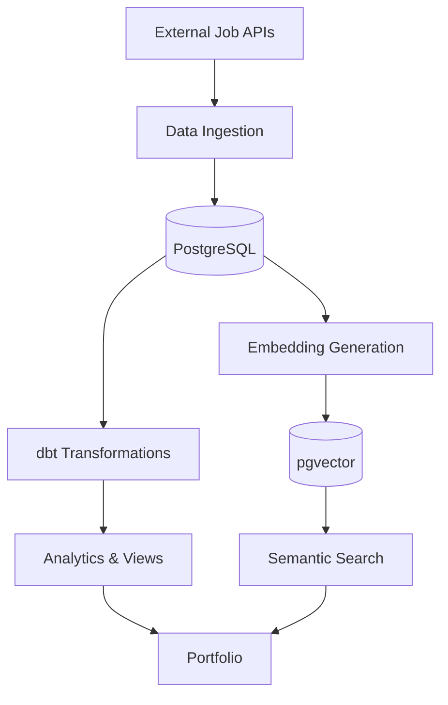

# Job Market Analytics & Semantic Search

An end-to-end data engineering project designed to collect, transform, analyze, and explore job listings through data analytics and semantic search.

The goal is to build a scalable ELT pipeline that turns raw job market data into actionable insights, while making job discovery possible through natural language queries rather than exact keyword matching.

## Overview

The project combines data engineering, analytics, and vector search to explore job market trends.

Job listings and their associated metadata are collected from external APIs, stored in PostgreSQL, and transformed using dbt. The pipeline also generates vector embeddings for job descriptions, enabling semantic search through natural language.

Some of the questions this project aims to answer:

- What are the most in-demand technical skills?
- How do salaries vary across roles and locations?
- Which technologies are gaining traction?
- What are the most common job requirements?
- Which job listings are semantically relevant to a given search, even when they don't share the same keywords?

## Architecture

The pipeline follows an ELT (Extract, Load, Transform) approach.

Apache Airflow orchestrates and schedules the different stages of the pipeline.

## Tech Stack

| Technology | Purpose |
|---|---|
| **Python** | Data pipeline development and integration |
| **Apache Airflow** | Workflow orchestration and scheduling |
| **dbt** | Data transformation and analytics |
| **PostgreSQL** | Relational database and data storage |
| **pgvector** | Vector storage and similarity search |
| **Embedding model** | Converting job descriptions into vector representations |

## Pipeline Workflow

### 1. Data Ingestion

Collect job listings and metadata from external sources.

The initial data source is the [Himalayas API](https://himalayas.app/api).

The ingestion process is designed to support multiple sources as the project evolves.

### 2. Data Storage

Store raw job listings and their associated metadata in PostgreSQL.

The database serves as the central storage layer for both structured job data and vector representations.

### 3. Data Transformation

Use dbt to clean, structure, and transform the collected data into analytical models.

Examples of planned transformations:

- Average salary by job title and location.
- Most requested technical skills.
- Distribution of job listings by category.
- Salary distribution across different roles.
- Most frequently requested technologies.

### 4. Embedding Generation & Semantic Search

Generate vector embeddings from job descriptions and store them in PostgreSQL using the pgvector extension.

This enables similarity-based searches using natural language.

For example, a query such as:

> "Remote backend engineering jobs involving distributed systems and Rust"

could return relevant listings even when the exact terms do not appear together in the job description.

### 5. Orchestration

Use Apache Airflow to orchestrate the entire workflow, manage dependencies, schedule executions, and monitor pipeline runs.

## Project Goals

Beyond building a functional pipeline, this project aims to explore several data engineering concepts:

- Building reliable and modular ELT workflows.
- Working with external APIs and heterogeneous data sources.
- Designing analytical data models with dbt.
- Integrating vector search into a relational database.
- Exploring the combination of traditional analytics and semantic search.
- Orchestrating end-to-end workflows with Apache Airflow.

## Roadmap

- [ ] Set up PostgreSQL database and pgvector extension.
- [ ] Implement job listing ingestion from the Himalayas API.
- [ ] Design the database schema.
- [ ] Build dbt models and analytical views.
- [ ] Integrate embedding generation.
- [ ] Implement semantic search using pgvector.
- [ ] Orchestrate the pipeline with Apache Airflow.
- [ ] Build a frontend to explore job listings and market insights.
- [ ] Publish the results on my personal portfolio.

## Results & Demo

The final goal is to make the collected data and analytical insights accessible through my personal portfolio:

**[rayan.world](https://rayan.world)**

The platform will showcase interesting job listings, labor market trends, and semantic job search capabilities.

---

*This is an ongoing personal project exploring modern data engineering tools and techniques.*